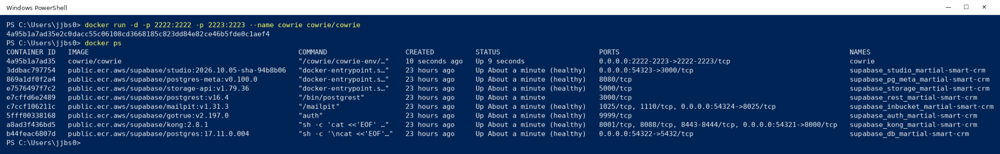
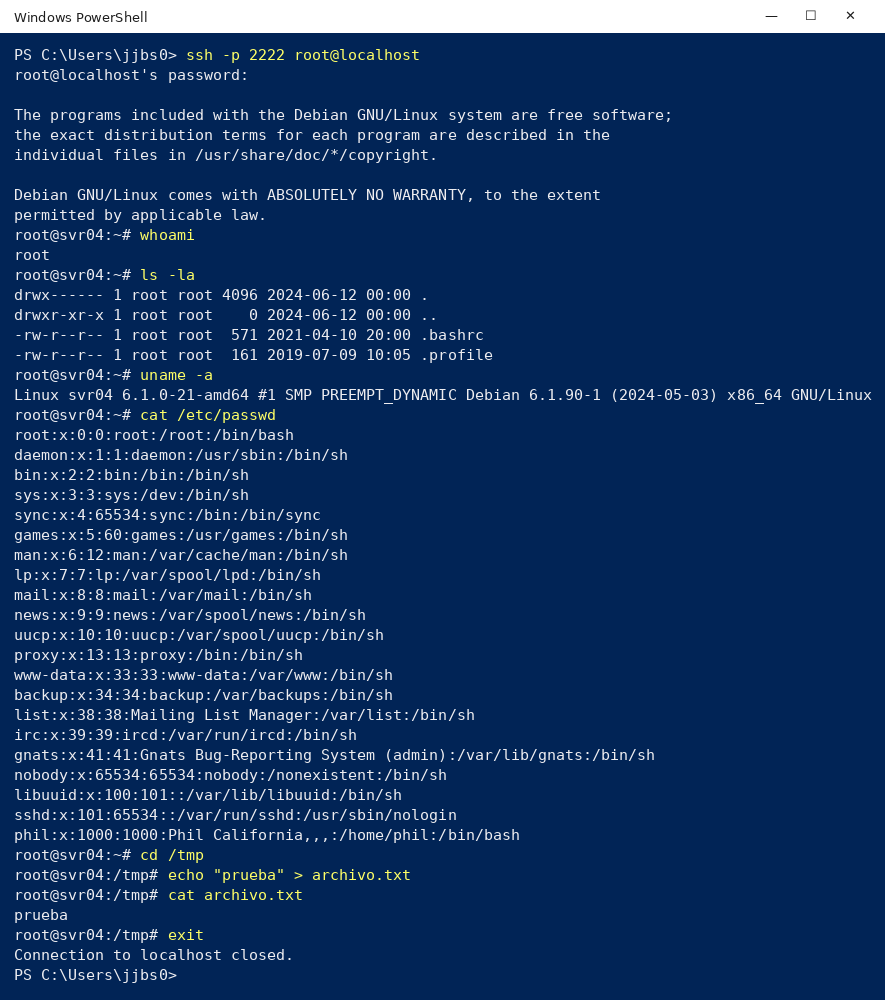
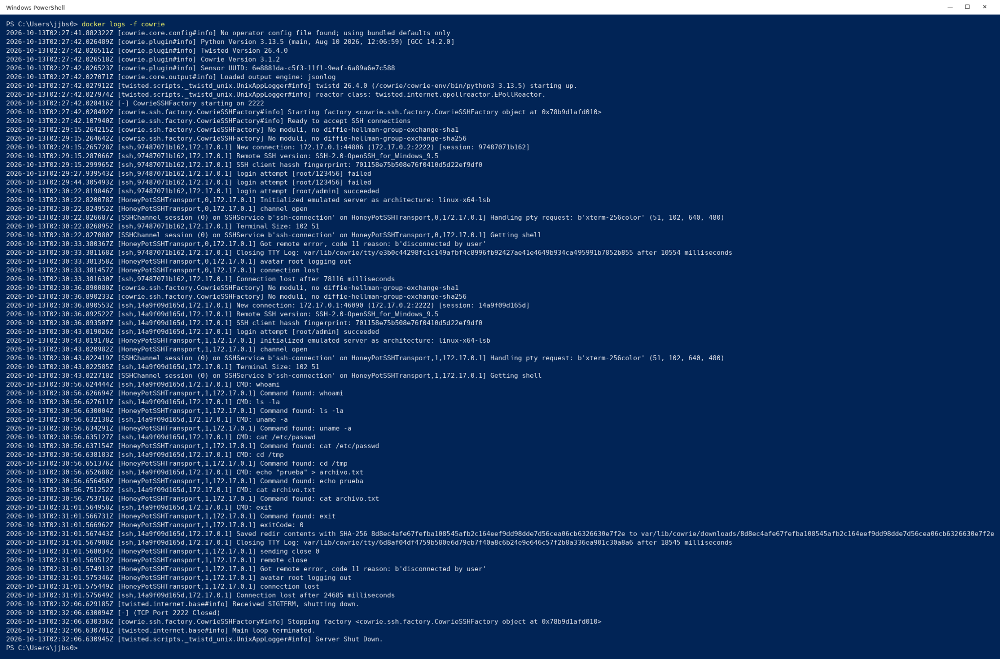
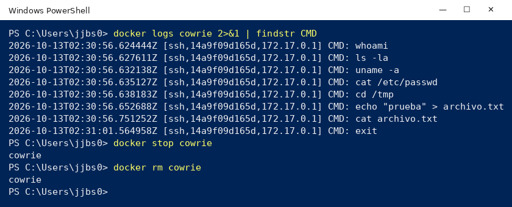

# Honeypot SSH con Cowrie

Laboratorio de detección de intrusiones: despliegue de un honeypot **Cowrie** con Docker, simulación de un atacante por SSH y análisis de lo que el honeypot registra. Incluye una investigación sobre cómo usan honeypots las grandes empresas tecnológicas.

## Contexto

- **Curso:** BCD 9220 – Seguridad de Sistemas Digitales (Universidad LEAD)
- **Laboratorio 6:** Honeypots Cowrie, *Detección de intrusión en acción*
- **Tema del grupo:** Honeypots en la industria, casos reales
- **Fecha:** octubre 2026
- **Modalidad:** trabajo grupal. La demostración técnica de este README se ejecutó en mi equipo.

## Qué es un honeypot

Un honeypot es un sistema señuelo: no protege nada real y ningún usuario legítimo tiene motivo para usarlo. Por eso **cualquier interacción con él es sospechosa** y sirve como señal de alerta. Su valor está en observar al atacante: qué credenciales prueba, qué comandos ejecuta, qué herramientas descarga y qué busca.

No reemplaza firewalls, controles de acceso ni IDS; es un mecanismo complementario de detección e inteligencia de amenazas.

**Cowrie** es un honeypot de interacción media que simula un servidor SSH/Telnet con una consola falsa y registra cada intento de login y cada comando.

## Demostración

### 1. Levantar el honeypot

```powershell
docker run -d -p 2222:2222 -p 2223:2223 --name cowrie cowrie/cowrie
docker ps
```

El contenedor queda escuchando en el puerto 2222 (SSH) y 2223 (Telnet).



### 2. Conectarse como atacante

```powershell
ssh -p 2222 root@localhost
```

Dentro de la consola falsa se ejecutaron siete comandos típicos de reconocimiento posterior a una intrusión:

```bash
whoami
ls -la
uname -a
cat /etc/passwd
cd /tmp
echo "prueba" > archivo.txt
cat archivo.txt
```

Cowrie responde como si fuera un Debian real (hostname `svr04`, un `/etc/passwd` creíble), pero nada de esto toca el sistema anfitrión.



### 3. Revisar lo que registró

```powershell
docker logs -f cowrie
```

El log muestra cada conexión, la huella del cliente SSH, **las credenciales probadas** (por ejemplo `root/123456` fallido y `root/admin` exitoso), cada comando y el cierre de la sesión, con marca de tiempo.



Para aislar solo los comandos del atacante y luego limpiar:

```powershell
docker logs cowrie 2>&1 | findstr CMD
docker stop cowrie
docker rm cowrie
```



## Honeypots en la industria

| Organización | Uso |
|---|---|
| **AWS – MadPot** | Red global de sensores honeypot. En 2023 AWS reportó más de 100 millones de interacciones diarias, unas 500 000 clasificables como maliciosas, sensores descubiertos en ~90 segundos y primeros intentos de explotación en ~3 minutos. |
| **Microsoft** | Honeytokens (cuentas y credenciales señuelo) en Defender for Identity que generan alertas al usarse, e infraestructura de engaño como `code.microsoft.com`. |
| **IBM X-Force** | Investigadores han descubierto nuevas familias de malware analizando lo capturado por honeypots. |
| **Google Cloud** | Detección de patrones como fuerza bruta SSH en logs y correlación de señales en Google Threat Intelligence. |
| **The Honeynet Project** | Organización sin fines de lucro (1999) detrás de herramientas abiertas como Honeyd, Dionaea y Conpot. |

Las cifras de MadPot son de un caso específico y no representan tiempos de detección generales de la industria.

### ¿Por qué invierten en honeypots?

- Descubrir técnicas, malware y vulnerabilidades nuevas antes de que lleguen a producción.
- Entender cómo se comportan los atacantes una vez dentro.
- Generar indicadores de compromiso y reglas de detección.
- Detectar intrusos de forma temprana: quien toca un señuelo se delata.

## Aprendizajes

- Un honeypot no necesita "detectar" nada: el simple hecho de recibir tráfico ya es la alerta.
- Los registros muestran exactamente qué contraseñas, herramientas y comandos usa un atacante, información útil para ajustar firewalls, monitoreo y políticas de acceso.
- Los ataques automatizados encuentran servicios expuestos en minutos, así que nunca hay que exponer un servicio "solo por un rato".

## Referencias

- [AWS Security Blog – How AWS threat intelligence deters threat actors (2023)](https://aws.amazon.com/blogs/security/how-aws-threat-intelligence-deters-threat-actors/)
- [Microsoft Tech Community – Identity-based honeytokens in Microsoft Defender for Identity (2023)](https://techcommunity.microsoft.com/blog/microsoftthreatprotectionblog/deceptive-defense-best-practices-for-identity-based-honeytokens-in-microsoft-def/3851641)
- [Microsoft Tech Community – The deception infrastructure behind code.microsoft.com (2024)](https://techcommunity.microsoft.com/blog/microsoftsentinelblog/examining-the-deception-infrastructure-in-place-behind-code-microsoft-com/4124464)
- [IBM Security Intelligence – Discover a new malware strain (2025)](https://www.ibm.com/think/podcasts/security-intelligence/discover-a-new-malware-strain)
- [Google Cloud – Introducing Google Threat Intelligence (2024)](https://cloud.google.com/blog/products/identity-security/introducing-google-threat-intelligence-actionable-threat-intelligence-at-google-scale-at-rsa)
- [The Honeynet Project – About](https://www.honeynet.org/about/)
- [Cowrie (GitHub)](https://github.com/cowrie/cowrie)
