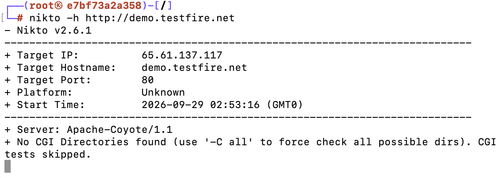

# Escaneo de servidores web con Nikto

Laboratorio de reconocimiento activo: uso de **Nikto** desde un contenedor de Kali Linux para identificar el software de un servidor web y empezar a mapear su superficie de ataque.

## Contexto

- **Curso:** BCD 9220 – Seguridad de Sistemas Digitales (Universidad LEAD), 2026-III
- **Laboratorio:** Análisis con Nikto, *"Dividiendo la superficie de ataque"*
- **Fecha:** setiembre 2026
- **Modalidad:** trabajo grupal (5 integrantes)

## Qué es Nikto

Nikto es un escáner de servidores web de código abierto, escrito en Perl y mantenido por CIRT, Inc. desde 2001. Envía miles de peticiones al servidor para detectar:

- Malas configuraciones del servidor y del software.
- Archivos y programas por defecto o inseguros.
- Versiones desactualizadas de componentes conocidos.
- Opciones del servidor HTTP y archivos índice múltiples.

### Activo, no pasivo

Nikto es una herramienta **activa** y **ruidosa**: prioriza la velocidad sobre el sigilo, así que su actividad queda claramente registrada en los logs del servidor y es fácil de detectar para un IDS/IPS. Un escáner pasivo, en cambio, no dejaría rastro en el objetivo.

### Lo que no hace

- **No explota vulnerabilidades.** Detecta y reporta; la explotación se hace con otras herramientas (Metasploit, Burp Suite). Puede exportar resultados en un formato que Metasploit puede leer.
- **No todo hallazgo es una vulnerabilidad.** Algunos chequeos son solo informativos y puede haber falsos positivos, por lo que los resultados se deben verificar manualmente.

## Ejecución

El escaneo se hizo contra `demo.testfire.net`, un sitio de demostración intencionalmente vulnerable que se usa para practicar pruebas de seguridad.

```bash
nikto -h http://demo.testfire.net
```



## Resultados

| Dato | Valor |
|---|---|
| IP del objetivo | 65.61.137.117 |
| Puerto | 80 |
| Servidor identificado | `Apache-Coyote/1.1` |
| Directorios CGI | No se encontraron (Nikto omitió las pruebas CGI) |

El hallazgo principal es la **identificación del servidor**: `Apache-Coyote/1.1` corresponde al conector HTTP de Apache Tomcat. Conocer la tecnología y su versión es uno de los primeros pasos de una auditoría, porque orienta las siguientes pruebas hacia vulnerabilidades y configuraciones inseguras conocidas de ese software. Nikto obtiene esta información solo a partir de las respuestas del servidor, sin explotar nada.

Para forzar la revisión de todos los directorios CGI posibles se puede usar la opción `-C all`.

## Aprendizajes

- El reconocimiento es la base de cualquier prueba de seguridad: antes de buscar fallas hay que saber qué tecnología hay del otro lado.
- Exponer la versión del servidor en los encabezados HTTP le da información gratuita a un atacante; ocultarla es una medida simple de hardening.
- Un escaneo activo solo debe hacerse contra sistemas propios o con autorización explícita.

## Referencias

- [CIRT.net – Nikto](https://cirt.net/nikto/)
- [Sullo – Nikto: Overview & Description (GitHub Wiki)](https://github.com/sullo/nikto/wiki/Overview-&-Description)
- [freeCodeCamp – Web Server Scanning With Nikto: A Beginner's Guide](https://www.freecodecamp.org/news/an-introduction-to-web-server-scanning-with-nikto/)
