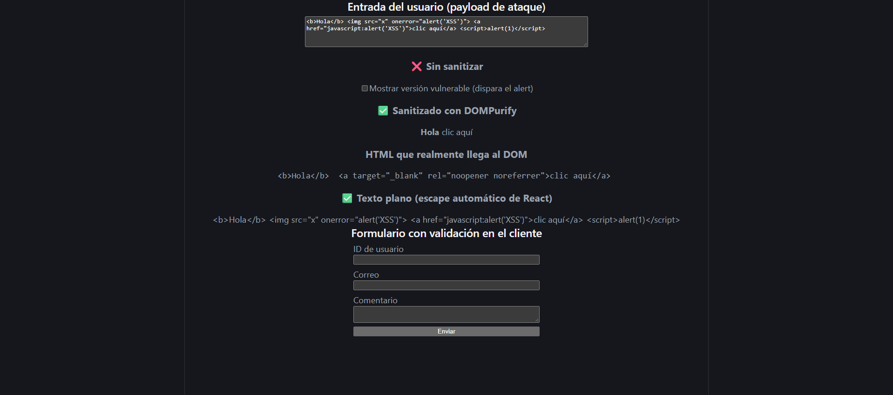
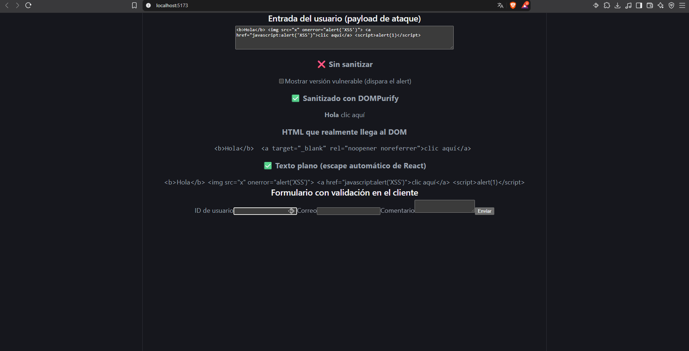
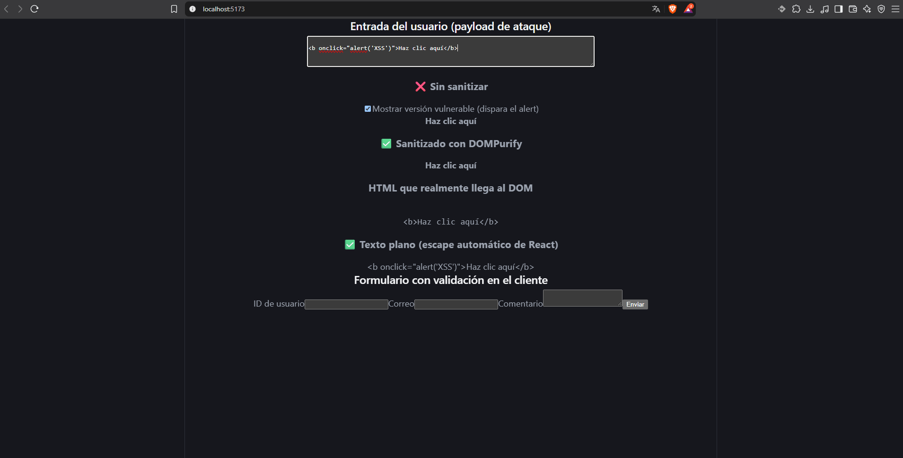
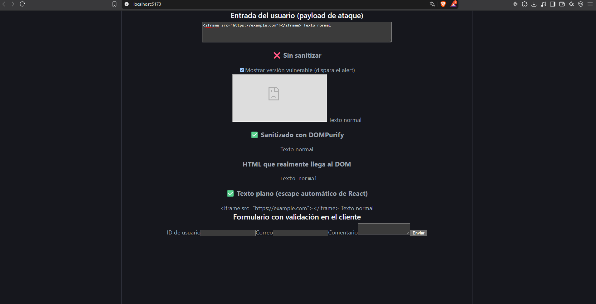
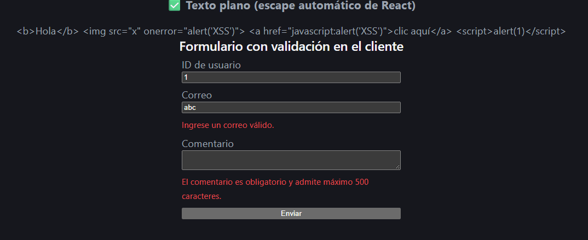
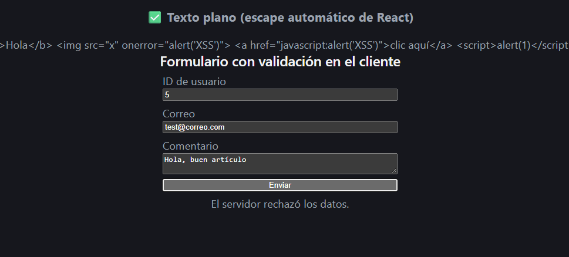

# Prevención de XSS en React: sanitización y validación de entradas

Demo en React que muestra, lado a lado, cómo un ataque **Cross-Site Scripting (XSS)** se ejecuta cuando se renderiza HTML del usuario sin control, y cómo se neutraliza con **DOMPurify** y con el escape automático de React. Incluye además un formulario con **validación de entradas en el cliente** basada en lista blanca.

## Contexto

Taller de investigación aplicada *Arquitectura de Software Seguro* del curso **BCD 9220 – Seguridad de Sistemas Digitales** (Universidad LEAD).

- **Grupo 2:** Validación de Entradas y Sanitización.
- **Mi rol:** Sub-equipo 3, Frontend (React). Este repositorio contiene mi parte del trabajo.
- El resto del grupo cubrió la investigación teórica, la arquitectura, el backend (consultas parametrizadas contra SQL Injection) y la documentación.

## Qué demuestra

| Componente | Qué hace | Por qué es seguro (o no) |
|---|---|---|
| `ComentarioVulnerable` | Inserta el HTML del usuario con `dangerouslySetInnerHTML` sin limpiar | ❌ El navegador ejecuta scripts, eventos como `onerror` y enlaces `javascript:` |
| `ComentarioSeguro` | Sanitiza con DOMPurify antes de insertar el HTML | ✅ Solo deja pasar etiquetas y atributos de una lista blanca |
| `ComentarioTextoPlano` | Renderiza la entrada como texto con `{texto}` | ✅ React escapa los caracteres especiales; nada se interpreta como HTML |
| `FormularioComentario` | Valida ID, correo y comentario antes de enviar | ✅ Rechaza formatos no permitidos (por ejemplo `1 OR 1=1` como ID) |

## Controles implementados

1. **Sanitización con lista blanca (DOMPurify).** Solo se permiten etiquetas de formato (`b`, `i`, `strong`, `p`, `ul`, `li`, `a`...) y los atributos `href`, `target` y `rel`. Todo lo demás (`<script>`, `<iframe>`, ``, `onclick`, `onerror`, `style`) se elimina.
2. **Filtro de URIs.** Los enlaces solo aceptan `http:`, `https:` y `mailto:`. Se bloquean `javascript:` y `data:`.
3. **Protección contra tabnabbing.** Un hook de DOMPurify agrega `target="_blank"` y `rel="noopener noreferrer"` a todos los enlaces.
4. **Texto plano por defecto.** Cuando el contenido no necesita formato, se usa el escape automático de React en lugar de insertar HTML.
5. **Validación en el cliente con lista blanca.** Se define qué formato es válido (tipo, patrón y longitud) en vez de intentar enumerar lo prohibido.

> **Importante:** la validación en el cliente mejora la experiencia de usuario, pero **no es una barrera de seguridad**. Un atacante puede omitirla enviando peticiones directamente con herramientas como curl o Postman. El servidor siempre debe volver a validar y usar consultas parametrizadas.

## Capturas

**1. Versión vulnerable: el `alert` se ejecuta**



**2. Payload por defecto sanitizado con DOMPurify:** se eliminan ``, `<script>` y el `href="javascript:..."`



**3. Evento `onclick`:** la versión vulnerable conserva el evento; la sanitizada solo deja `<b>`



**4. Iframe:** se inyecta en la versión vulnerable y se elimina por completo en la sanitizada



**5. Validación en el cliente: entradas inválidas bloqueadas antes de enviarse**



**6. Datos válidos:** pasan la validación del cliente y la decisión final queda en el servidor (sin backend, la petición se rechaza)



## Cómo ejecutarlo

Requisito: [Node.js](https://nodejs.org) versión LTS.

```bash
npm install
npm run dev
```

Abrir http://localhost:5173 en el navegador.

## Pruebas sugeridas

| Prueba | Entrada | Resultado esperado |
|---|---|---|
| XSS con imagen | Viene cargada por defecto | Versión vulnerable: se ejecuta el `alert`. Versión sanitizada: solo queda el texto y el enlace sin `href` |
| Evento `onclick` | `<b onclick="alert('XSS')">Haz clic aquí</b>` | Se conserva `<b>` y se elimina `onclick` |
| Iframe | `<iframe src="https://example.com"></iframe> Texto normal` | El `<iframe>` se elimina por completo |
| Formulario inválido | ID `1 OR 1=1`, correo `abc`, comentario vacío | Tres mensajes de error; no se envía la petición |
| Formulario válido | ID `5`, correo `test@correo.com`, un comentario | Pasa la validación del cliente; la respuesta depende del backend |

## Estructura

lab-xss-sanitizacion-react/
├── docs/ # Capturas de las pruebas
├── public/
├── src/
│ ├── SanitizacionFrontend.jsx # Componentes de la demo
│ ├── main.jsx # Punto de entrada
│ └── index.css # Estilos
├── index.html
├── package.json
└── vite.config.js


## Limitaciones

- El repositorio no incluye backend. El formulario envía a `/api/comentarios`, por lo que sin servidor muestra un error de conexión o de rechazo; esto es esperado.
- La versión vulnerable se incluye solo con fines educativos y se activa manualmente con un checkbox.

## Referencias

- [OWASP – Cross Site Scripting Prevention Cheat Sheet](https://cheatsheetseries.owasp.org/cheatsheets/Cross_Site_Scripting_Prevention_Cheat_Sheet.html)
- [OWASP – Input Validation Cheat Sheet](https://cheatsheetseries.owasp.org/cheatsheets/Input_Validation_Cheat_Sheet.html)
- [DOMPurify (GitHub)](https://github.com/cure53/DOMPurify)
- [React – `dangerouslySetInnerHTML`](https://react.dev/reference/react-dom/components/common#dangerously-setting-the-inner-html)
